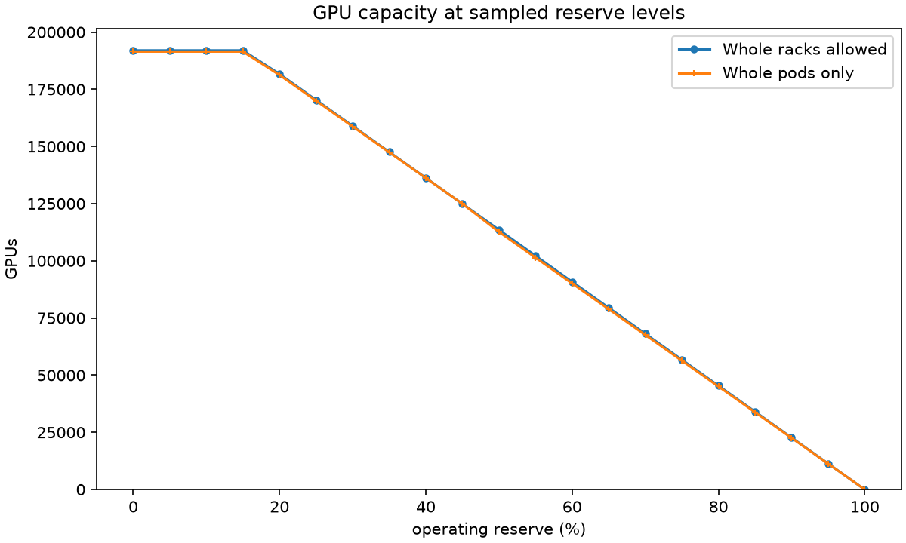
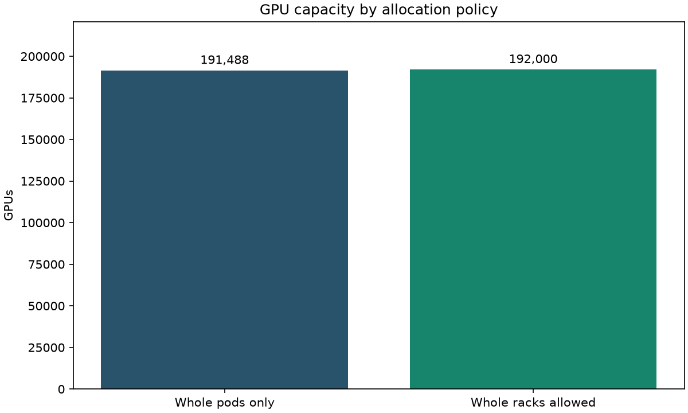
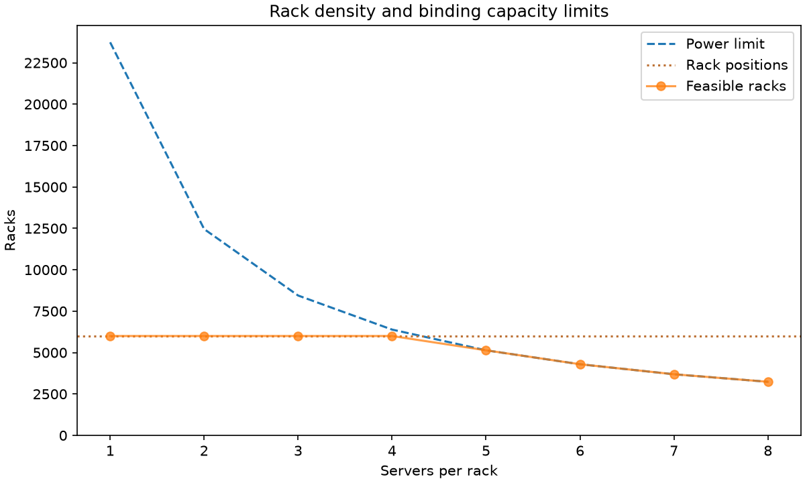

# Reserve and partial-pod planning / 预留与部分 Pod

Use the new offline Python tool, or ask the CLI: “使用 DGX B200 基准，在 500 MW
设施中预留 10% 运行功率和 20% 增长功率，均以设施总功率为基数。比较完整 Pod 与部分 Pod。”

```python
from agent import compare_allocations

data = compare_allocations({
    "parameters": {"facility_capacity_mw": 500},
    "use_baseline_defaults": True,
    "operating_reserve_pct": 10,
    "growth_reserve_pct": 20,
    "reserve_basis": "facility",
})
print(data["allocation"])
```

Percentages are planning inputs (10 means 10%), not required reliability margins.
Each must be finite and in [0,100]. Omission means zero. Operating reserve is a
percentage of nameplate facility MW. For growth choose **facility** (same base)
or **after_operating** (remaining facility MW). Both positive percentages require an
explicit basis. Additive reserves cannot exceed 100% together. A fully reserved
facility is valid and deploys zero racks. The response includes the budget,
component reserves, request/default sources and both plans; see reserve_inputs,
reserve_sources, inputs and provenance for the calculation assumptions.

Whole-pod allocation rounds down to complete pods. Partial allocation first
packs full pods and then complete, identical racks in at most one incomplete pod.
It does not permit fractional racks, servers or GPUs. Rack facility MW includes
server and external network power multiplied by PUE. No fixed pod-level overhead
or shared-infrastructure readiness is asserted. For each plan:
facility MW = operating reserve + growth reserve + used MW + space-limited unused MW + packing remainder.
The remainder is deployable budget left after integer packing, not an intentional reserve.

运行预留按设施总 MW 计算，增长预留的基数由调用方选择。示例的两种口径分别得到
350 MW 和 360 MW 可部署预算；不替用户默认选择。只按整架增加，结果分开列出
完整 Pod 数与尾 Pod 的机架数。原工具保持只按完整 Pod 计算，不会隐式启用预留。
可选机架位置和图表示例见下文。此模型不验证冷却、设备安装尺寸或冗余。

## Rack-space constraint / 机架位置上限

`rack_limit` is an optional nonnegative integer counting usable rack positions
for this deployment, not rack U height or floor area. Zero means no rack can be
installed; null or omission leaves the original power-only calculation unchanged.
Power-supported racks are rounded down after reserves. Compare that integer with
the supplied space cap: report power, space, or both when the integer limits tie.
Then round down to whole pods if requested. Space-stranded power equals the number
of otherwise power-supported racks excluded by space times facility MW per rack.
The residual after that is integer-packing remainder.

例如：按基准配置，500 MW，运行预留 10%，机架位置上限 6,000。功率预算为
450 MW；以每架 0.07044 MW 计算，功率支持 6,388 架，实际由位置限制到
6,000 架。整 Pod 方案只能使用 5,984 架；部分 Pod 方案可利用全部 6,000 架。
这里假定每个位置可容纳一架，不推断机房面积、U 位、承重或冷却可行性。

## Chart gallery / 规划图表示例

These PNGs use the example above. Reproduce them from the repository root:

```sh
python -m examples.planning_charts
```

- **Reserve vs GPU / 预留与 GPU 数：** Sample operating reserve when growth is zero;
  otherwise sample growth. Hold the other reserve and rack cap fixed. The grid
  uses five percentage points plus the source scenario's value; infeasible additive
  points are omitted. Lines connect sampled values, not exact transition thresholds.
  
- **Whole vs partial / 完整与部分 Pod：** GPU counts under the same budget and rack cap.
  
- **Rack density / 密度与约束：** Vary servers per rack (1–8 plus the scenario value),
  holding server type, network power per rack, and other assumptions fixed. Compare
  power-supported racks, available positions (when specified), and feasible racks.
  

For conversational use, first obtain a `compare_allocations` result, then request
a chart. The host accepts only its stored result ID for these plots and recomputes
the chart rows; the model does not supply arbitrary paths or numeric series.
对话示例：“按 DGX B200 基准，500 MW、10% 运行预留、最多 6000 架，比较两种分配方式，
说明瓶颈并画机架密度图。”
